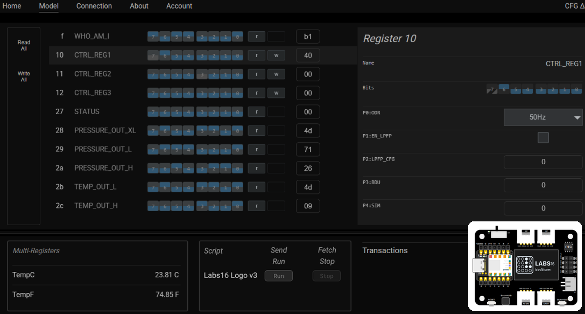
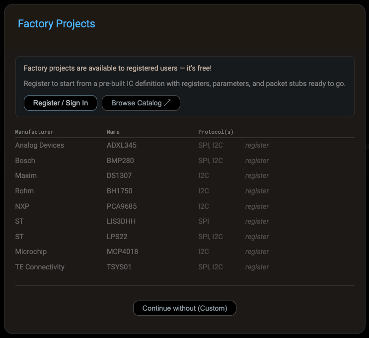
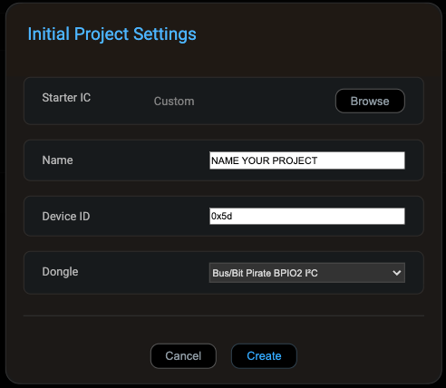
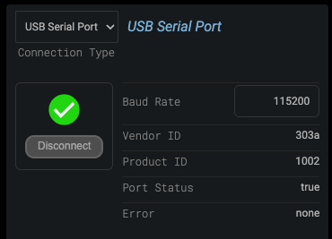
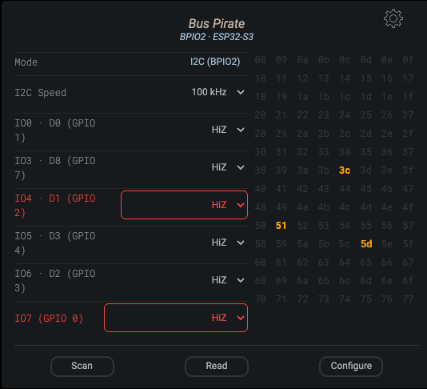
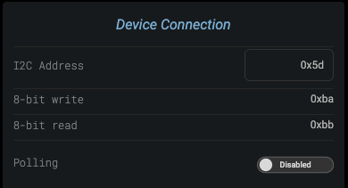
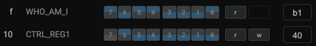
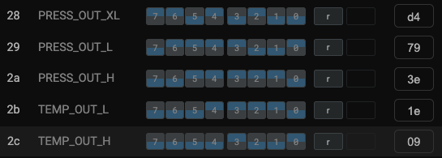
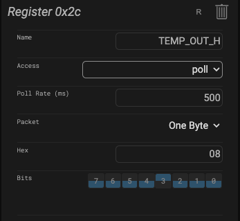
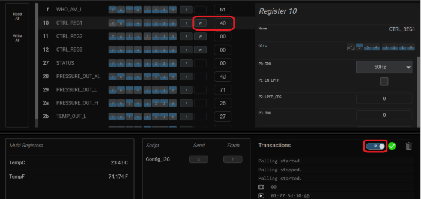

# ESP32S3_BPIO2_I2CBridge
Seeed XIAO ESP32-S3 running [ESP32 Bit Pirate](https://github.com/geo-tp/ESP32-Bit-Pirate) in BPIO2 mode as an I2C Bridge, uses the XIAO expansion board's Grove connector for i2c communication. Everything is done in the browser: flash it, put it into BPIO2 mode and control your peripherals with UXB-300, with no additional code changes.

## 📁 Repository Structure

*   **`/img`**: Screenshots used in this README and the step-by-step guide.
*   The firmware is provided via the [ESP32 Bit Pirate](https://github.com/geo-tp/ESP32-Bit-Pirate) project by geo-tp.

## 🚀 How to Install

### Step 1: Flash Bit Pirate
You don't need the Arduino IDE for this.
1. Open the [ESP32 Bit Pirate web flasher](https://geo-tp.github.io/ESP32-Bit-Pirate/webflasher/) in **Chrome** or **Edge**.
2. Hold down the **BOOT** button on the XIAO while plugging it in with a USB cable.
3. Select **Xiao ESP32-S3**.
4. Click **Flash selected firmware**.

### Step 2: Put it in BPIO2 mode
1. Open the [Bit Pirate web serial terminal](https://geo-tp.github.io/ESP32-Bit-Pirate/web-tools/web-serial-terminal/) and click **Connect**.
2. Press any key, then type:

```
HIZ> mode
Mode Number > 12
Configure SD card GPIOs for USB? [n]: <Enter>
USB> adapters
Enter index (default 9): 8
BPIO2 GPIOs IO0..IO7 [1 2 4 3 6 5 0 7]: 1 6 5 7 2 4 3 0
```

3. The board will automatically reboot into BPIO2 adapter mode and the terminal closes. Press **RESET** to return to normal Bit Pirate mode.

NOTE: Avoid pressing **RESET** while you're using UXB-300. A reset takes the XIAO out of BPIO2 mode, and you'd have to repeat Step 2 to get it back.

## 🛠️ Requirements
*   **Hardware:** [Seeed XIAO ESP32-S3](https://www.digikey.com/en/products/detail/seeed-technology-co-ltd/113991114/19285530), [Seeed XIAO expansion board](https://www.digikey.com/en/products/detail/seeed-technology-co-ltd/103030356/13572081) (optional), [Adafruit LPS22](https://www.adafruit.com/product/4633), [Grove to STEMMA QT cable](https://www.adafruit.com/product/4528) (both also at DigiKey).
*   **Software:** Chrome or Edge on desktop. Nothing to install.

## 🧱 BPIO2 Pin Map
The GPIO list `1 6 5 7 2 4 3 0` maps BPIO2 IO0..IO7 to these XIAO pins:

| BPIO2 | I2C | SPI  | XIAO GPIO | XIAO pin |
|-------|-----|------|-----------|----------|
| IO0   | aux | CS   | 1         | D0       |
| IO1   | SCL | SCK  | 6         | D5       |
| IO2   | SDA | MOSI | 5         | D4       |
| IO3   | aux | MISO | 7         | D8       |
| IO4   | aux | aux  | 2         | D1       |
| IO5   | aux | aux  | 4         | D3       |
| IO6   | aux | aux  | 3         | D2       |
| IO7   | aux | aux  | 0         | BOOT     |

NOTE: On the XIAO expansion board, IO4 (D1, GPIO2) and IO7 (GPIO0) are connected to hardware on the board and don't stay at HiZ on their own. Set both to **HiZ** in UXB-300 before you scan. If you are wired directly to the XIAO with no expansion board, this doesn't matter.

## 🎚️ GUI Control 

The [UXB-300](https://uxb-300.labs16.com/?utm_source=github&utm_medium=social&utm_campaign=bitpirate-nov&utm_content=readme) is a browser based GUI builder that lets you wire up register-level controls with any target IC.



### Try it now
UXB-300 LPS22 GUI: [https://apps.labs16.com/lightwoheat/BPIO2_I2C_LPS22](https://apps.labs16.com/lightwoheat/BPIO2_I2C_LPS22?utm_source=github&utm_medium=social&utm_campaign=bitpirate-nov&utm_content=gui-link)

With the XIAO in BPIO2 mode and the LPS22 plugged in, open the link above. On the Connection page, click **Connect**, pick **ESP32 Bit Pirate**, and click **Connect**. Then on the Model page, click **Write All** (top left) to configure the LPS22 and turn on **Polling**. TempC and TempF update live.

### Make it yours
Register free to unlock the Factory Projects catalog of ready-made ICs, then save and tweak your own copy.

Open [UXB-300](https://uxb-300.labs16.com/?utm_source=github&utm_medium=social&utm_campaign=bitpirate-nov&utm_content=readme), click **Create**, then **Browse** and **Register / Sign In**.



Signed in, **Select** the **LPS22HB**, set Device ID to **0x5D**, choose **Bus/Bit Pirate BPIO2 I2C** and click **Create**.



Now connect: on the Connection page, click **Connect** and pick **ESP32 Bit Pirate**.



Click **Scan**, and the Adafruit LPS22 shows up at **0x5D** (set IO4 and IO7 to HiZ first if you're on the expansion board).



Set that as the Device Address.



A fresh project starts the LPS22 at its power-on defaults, so wake it up: in **Backstage**, type **40** into CTRL_REG1 (0x10) and press Enter.



Read registers **0x28–0x2C** for the raw pressure and temperature bytes.



To watch them live, open the **Editor**, change Access on 0x28–0x2C from Read to **Poll** and set the Poll Rate (500 ms is a good start).



Then switch on **P** under Transactions.


That's it: the pressure and temperature calculations now update in real time.



### Rather not sign in?
Click **Continue without (Custom)** and build the LPS22 model yourself with the [step-by-step guide on Adafruit Playground](https://adafruit-playground.com/u/lightwoheat/pages/xiao-esp32-s3-bit-pirate-as-i2c-bridge-with-gui-control). Save the project when you're done.

## 🤝 Credits
Firmware: [ESP32 Bit Pirate](https://github.com/geo-tp/ESP32-Bit-Pirate) by geo-tp.
